# col-gazetteers

[](https://github.com/CatalogueOfLife/col-gazetteers/actions/workflows/test.yml)

▶ **Live viewer:** <https://catalogueoflife.github.io/col-gazetteers/> — interactive map with build metadata per gazetteer; pick any region to overlay it on a GBIF/OpenStreetMap basemap.

The named areas of the [Catalogue of Life](https://www.catalogueoflife.org/). A species' distribution in [ChecklistBank](https://www.checklistbank.org/) can refer to an area by gazetteer and id, like `iso:DE`, `tdwg:ABT` or `realm:Palearctic`. The ChecklistBank API uses this repository to resolve the English labels of those ids, and to serve their shapes via `/vocab/area/{prefix}:{id}` with `Accept: application/geo+json`.

This repo holds:

1. **Built assets** — a normalized on-disk tree (see [On-disk layout](#on-disk-layout)).
2. **Build scripts** — code that turns upstream sources into that tree.

## Gazetteers

Each gazetteer has a description of what it is, how its shapes were made, its sources and how to cite them, with a world map.

| Prefix | Gazetteer | What it covers | Id format | Areas | Map |
|---|---|---|---|---:|---|
| `continent` | [Continents](continent/README.md) | Land, in 7 continents with physical boundaries | CamelCase name, `NorthAmerica` | 7 | <a href="continent/map.svg">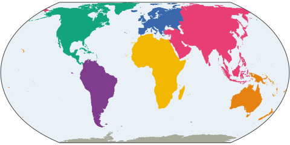</a> |
| `realm` | [Biogeographic Realms](realm/README.md) | The whole globe, in 8 terrestrial + 11 marine realms | CamelCase name, `Palearctic`, `SouthernOcean` | 19 | <a href="realm/map.svg">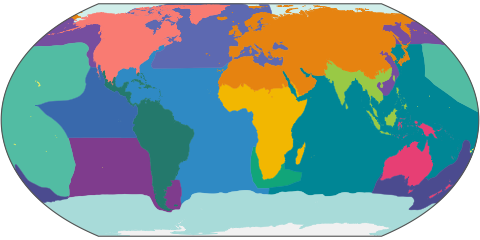</a> |
| `iso` | [ISO 3166](iso/README.md) | Countries and their subdivisions, with historic codes | Upper-case code, `US`, `US-CA`, `YU` | 5,835 | <a href="iso/map.svg">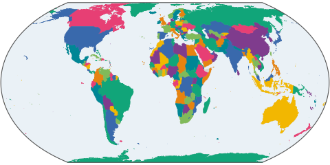</a> |
| `tdwg` | [TDWG WGSRPD](tdwg/README.md) | Land, in botanical continents, regions, countries and units | Level-specific, `1`, `10`, `ABT`, `ABT-OO` | 1,040 | <a href="tdwg/map.svg">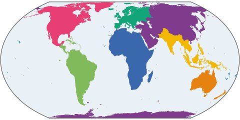</a> |
| `teow` | [Terrestrial Ecoregions of the World](teow/README.md) | Land, in ecoregions | Integer `ECO_ID`, `1` | 847 | <a href="teow/map.svg">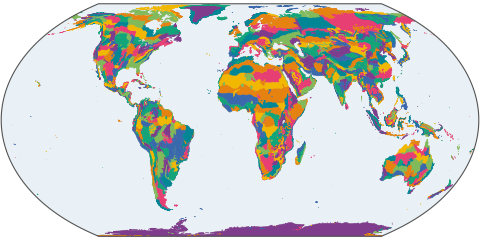</a> |
| `gi` | [Global Islands](gi/README.md) | Named islands over 1 km² | Integer `ALL_Uniq`, `281836` | 15,139 | <a href="gi/map.svg">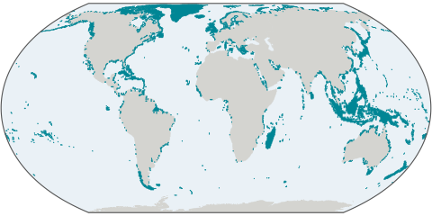</a> |
| `wdpa` | [World Database on Protected Areas](wdpa/README.md) | Protected areas, **labels only** | Integer `WDPAID`, `1000` | 506,250 | none, the licence rules out geometries |
| `fao` | [FAO Major Fishing Areas](fao/README.md) | The sea, in fishery statistics areas of all levels | Dotted code, `37`, `37.4.1`, `21.3.P.n` | 348 | <a href="fao/map.svg">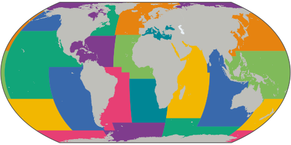</a> |
| `iho` | [IHO Sea Areas](iho/README.md) | The sea, in named oceans and seas | S-23 number, case-sensitive, `23`, `28A`, `28a` | 101 | <a href="iho/map.svg">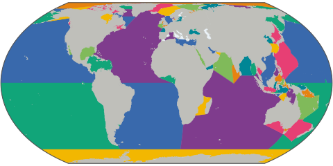</a> |
| `longhurst` | [Longhurst Provinces](longhurst/README.md) | The ocean, in biogeochemical provinces | 4-letter code, `NADR` | 54 | <a href="longhurst/map.svg">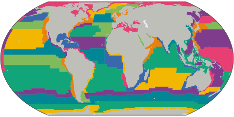</a> |
| `costello` | [Marine Biogeographic Realms](costello/README.md) | The ocean, in 30 realms defined by species | Integer `1`–`30` | 30 | <a href="costello/map.svg">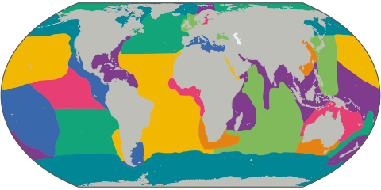</a> |
| `mrgid` | [Marine Regions Gazetteer](mrgid/README.md) | Named places, mostly at sea | Integer MRGID, `8371` | 63,911 | <a href="mrgid/map.svg">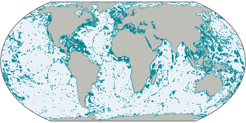</a> |

The authoritative list of gazetteers is the backend enum [`Gazetteer.java`](https://github.com/CatalogueOfLife/backend/blob/master/api/src/main/java/life/catalogue/api/vocab/area/Gazetteer.java), which also has `text`, without geometry. Adding or removing a gazetteer needs changes in both repositories.

Licences and required citations are collected in [`ATTRIBUTIONS.md`](ATTRIBUTIONS.md).


## On-disk layout

```
<gazetteerDir>/
  <prefix>/
    labels.tsv                 # one row per area: <id>\t<english-name>
    features/<id>.geojson      # one GeoJSON Feature per file; none for wdpa
    README.md                  # what it is and how it was made
    build.json                 # build provenance — see below
    overview.geojson           # a small world map of it; none for wdpa
    map.svg, map.png           # the overview rendered; none for wdpa
    map-thumb.png              # a preview of the map; none for wdpa
```

`iso` also has `sources.tsv`, explained in [its description](iso/README.md).

### `labels.tsv`

- UTF-8, no header, tab-delimited.
- Column 1: the area id as the backend will receive it (e.g. `37.4.1` for FAO, `8371` for MRGID — **without** the gazetteer prefix).
- Column 2: the English label.
- Further columns are optional: `fao` has French and Spanish labels, `mrgid` the place type.
- Order does not matter; the backend reads the file once at startup into a hash map.

### `overview.geojson`

A small world map of the gazetteer in one file, for consumers that would otherwise fetch every feature. Built by [`scripts/build_overviews.py`](scripts/build_overviews.py) from the committed `features/` and `labels.tsv`, with nothing downloaded. Each gazetteer's description says what is left out.

- **Area overviews** (`continent`, `tdwg`, `iso`, `fao`, `iho`, `realm`, `longhurst`, `costello`, `teow`) hold the high level areas as simplified features with the properties `id`, `name` and `color`. `color` is a palette index from 0 to 7 that differs between neighbouring areas. `continent` and `realm` are simplified together (shapely `coverage_simplify`), so they keep sharing their borders. Each of their areas also carries `fill`, a fixed hex colour from the [CARTO schemes](https://carto.com/carto-colors/); `fill` is the [simplestyle-spec](https://github.com/mapbox/simplestyle-spec) name that map previews such as geojson.io use.
- **Coverage overviews** (`gi`, `mrgid`) have too many entries to show one by one. They hold a single MultiPolygon of the 0.5° grid cells that entries touch, with the properties `coverage: true`, `count` and `omitted`, the number of entries shown and left out.

### `map.svg`, `map.png`, `map-thumb.png`

The overview in the Equal Earth projection, rendered by [`scripts/build_maps.py`](scripts/build_maps.py), with text kept as text in the SVG. Colours only tell neighbours apart, unless the overview has a `fill`. The rebuild only redraws maps whose overview changed.

`map-thumb.png` is a preview of exactly 480×240 px: the map alone, without title or labels, on a transparent background.

### `features/<id>.geojson`

- A single GeoJSON `Feature` object (not a `FeatureCollection`).
- Filename is the bare id exactly as it appears in column 1 of `labels.tsv` (**case-preserved**), with whitespace / colons / slashes collapsed to `-`. The backend serves these as `<dir>/<prefix>/features/<id>.geojson` and rejects ids that don't normalize to a path under `features/`. Case-preservation matters: IHO S-23 distinguishes `28A` (Mediterranean Sea — Western Basin) from `28a` (Strait of Gibraltar) — the tree must therefore live on a **case-sensitive filesystem** (APFS-cs / ext4 / xfs). Default macOS HFS+ / APFS-ci will silently merge such filenames.
- `properties.name` should mirror the label in `labels.tsv` (the backend reads names from `labels.tsv`, not from the GeoJSON, but consumers fetching the GeoJSON expect a usable name).
- Geometries are in either **EPSG:4326** (WGS84 lon/lat — GeoJSON-native, RFC 7946 default) or **EPSG:3857** (Web Mercator — convenient for web-map overlays without client-side reprojection). The CRS is a build-time choice (see [`scripts/README.md`](scripts/README.md)) and is uniform across all gazetteers in a given build. Keep precision reasonable: 5–6 decimals for 4326, ~1 m (no decimals) for 3857.
- Geometries are simplified with Douglas–Peucker (see [Simplification](#simplification) below). Built tolerance is recorded in each `<prefix>/build.json` as `simplify_tolerance`.
- Multi-source prefixes (`mrgid`, `tdwg`, `iso`) stamp each feature with a `properties.source` string that names the upstream layer it came from.

### `build.json`

Per-gazetteer build manifest written by the script. Not consumed by the backend (which only reads `labels.tsv` and `features/`), but committed so reviewers and operators can see when the tree was last refreshed and from which exact upstream artifact. Format is JSON; example shape:

```json
{
  "prefix": "iho",
  "built_at": "2026-05-15T19:54:21Z",
  "crs": "EPSG:4326",
  "simplify_tolerance": 0.001,
  "feature_count": 99,
  "label_count": 99,
  "sources": [
    {
      "role": "shapefile",
      "name": "World_Seas_IHO_v3",
      "url": "https://www.marineregions.org/download_file.php?fn=World_Seas_IHO_v3",
      "filename": "World_Seas_IHO_v3.zip",
      "downloaded_at": "2026-05-15T19:50:11Z",
      "size_bytes": 12345678,
      "md5": "d41d8cd98f00b204e9800998ecf8427e",
      "sha256": "e3b0c44298fc1c149afbf4c8996fb924…",
      "upstream_version": "v3 (2021-11)"
    }
  ],
  "tools": {
    "ogr2ogr": "GDAL 3.8.4, released 2024/02/08",
    "python": "3.11.7",
    "build_script_commit": "4591267"
  }
}
```

Field notes:
- `sources` is an array because some prefixes pull from multiple inputs (e.g. `mrgid` = shapefile + REST API label enrichment). Each entry carries its own `url`, `md5`, etc.
- `md5` / `sha256` are computed over the downloaded artifact **as received** (the zip, not the extracted shapefiles).
- `upstream_version` is best-effort — empty string if the source doesn't expose a version.
- `build_script_commit` is the short SHA of `HEAD` at build time. Reviewers can pair it with `built_at` to reproduce the run.

### Contract

Anything outside the structure above is ignored by the backend. Sibling files (e.g. `fao/source.shp.zip`, `fao/build.log`) are fine but should not be committed — sources are gitignored under `/sources/` and re-fetched by the build scripts.

## Build scripts

See [`scripts/README.md`](scripts/README.md) for full detail. In short: Python 3.11+ orchestration, `ogr2ogr` (GDAL) for the heavy shapefile → GeoJSON conversion, `requests` for downloads. Each `scripts/<prefix>/build.py` is idempotent — pulls (or reuses cached) source, runs ogr2ogr, splits per feature, writes `<prefix>/labels.tsv` and `<prefix>/build.json`. Target CRS is configurable via `GAZETTEER_CRS=4326|3857`. [`scripts/rebuild.sh`](scripts/rebuild.sh), run by the rebuild workflows, then updates the overviews and maps and commits what changed.

## Storage

Plain git. Features are text GeoJSON; git's pack format compresses them ~70 % (largest single feature is ~15 MB, well under GitHub's per-file limits). No Git LFS, no release tarballs — deploy just clones / pulls the repo.

Note that file *count* matters as much as byte size: a tree of many small files costs far more in allocated blocks and in `git status` / clone time than its content size suggests — `gi` is 22 MB of JSON but 15,139 files, which occupy ~71 MB on a 4 KB-block filesystem.

## Simplification

Geometries are simplified with Douglas–Peucker via `ogr2ogr -simplify`, apart from `continent` and `realm`, which keep their shared borders by other means. The tolerance is expressed in the units of the target CRS — **degrees** for EPSG:4326, **metres** for EPSG:3857. Douglas–Peucker guarantees no point in a built feature deviates from the original by more than the tolerance.

**Current default: `0.005°` (~550 m at the equator)** for EPSG:4326 builds, `500 m` for EPSG:3857.

The default was chosen empirically. We built `iho` (101 features, mostly complex sea boundaries) and an early `mrgid` (808 features) at three tolerances and compared:

| Tolerance | Real-world | `iho` total | `mrgid` total | Notes |
|---|---|---|---|---|
| `0.001°` | ~110 m | 74 MB | 196 MB | Sub-pixel detail at z6+; previous default. |
| **`0.005°`** | **~550 m** | **34 MB (−54 %)** | **94 MB (−52 %)** | **Current default.** Indistinguishable from `0.001°` at z2–z6 world view, big disk win. |
| `0.01°` | ~1.1 km | 28 MB (−62 %) | 76 MB (−61 %) | Visible degradation on small islands, narrow EEZs, fjord coastlines. |

So most of the win came at `0.005°`; tightening further to `0.01°` saves only ~20 % more disk for a noticeable loss of fidelity on small features. Since this tree is primarily consumed at world / regional zoom, `0.005°` is the sweet spot.

Override per build: `GAZETTEER_SIMPLIFY=0.0005 python scripts/iho/build.py`, or pass `--simplify 0.0005`. Same value is recorded into each `<prefix>/build.json`.

`gi` overrides this to `0.002°`, as islands are neither large nor smooth. See [its description](gi/README.md).

## Deploy

The `CatalogueOfLife/deploy` repo (private) needs to:
1. Clone this repo to a known path on each backend VM.
2. Run `git pull` on a cadence (or after release-cuts) to refresh data.
3. Point `gazetteerDir` in the env-specific Dropwizard config at the checkout.

## License

Scripts and metadata files in this repo: **Apache 2.0**.

Generated data files are derived from third-party sources, each with its own licence and citation requirement — see [`ATTRIBUTIONS.md`](ATTRIBUTIONS.md).
