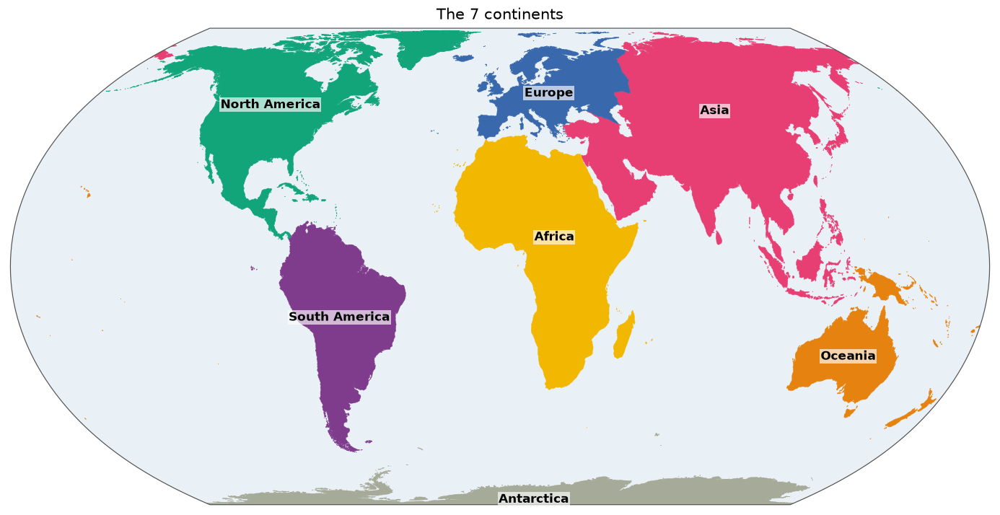

# Continents

Most people learn at school that the world's land is divided into continents. There is no single official list of them, and where one ends and the next begins is partly a matter of convention. This gazetteer gives the 7 continents of the most widely taught model a fixed definition and an exact outline, so that a species' distribution can say *Africa* or *South America* and mean a particular piece of land.

*The 7 continents, drawn from [`overview.geojson`](overview.geojson). Click for the [SVG](map.svg).*

It replaces the `Continent` vocabulary of the ChecklistBank backend, which listed the same 7 names with no shapes. That enumeration split the Americas with North America "including the Caribbean and reaching down and including Panama", and this gazetteer keeps that rule.

| Id | Label |
|---|---|
| `Africa` | Africa |
| `Antarctica` | Antarctica |
| `Asia` | Asia |
| `Europe` | Europe |
| `NorthAmerica` | North America |
| `Oceania` | Oceania |
| `SouthAmerica` | South America |

## Sources and attribution

- **Natural Earth**, public domain: [10m Admin 0 map subunits](https://www.naturalearthdata.com/downloads/10m-cultural-vectors/10m-admin-0-details/) for the land and its first assignment to continents, and [10m rivers and lake centerlines](https://www.naturalearthdata.com/downloads/10m-physical-vectors/10m-rivers-lake-centerlines/) for the Ural River and the Suez Canal. Made with Natural Earth.
- **Copernicus WorldDEM-90** (GLO-90), for the two mountain divides in [`scripts/continent/ridges.geojson`](../scripts/continent/ridges.geojson). <https://doi.org/10.5270/ESA-c5d3d65>. The divides were *produced using Copernicus WorldDEM™-90 © DLR e.V. 2010-2014 and © Airbus Defence and Space GmbH 2014-2018 provided under COPERNICUS by the European Union and ESA; all rights reserved*. The organisations in charge of the Copernicus programme by law or by delegation do not incur any liability for any use of the Copernicus WorldDEM™-90. Anyone redistributing the divides must keep this notice ([licence](https://dataspace.copernicus.eu/explore-data/data-collections/copernicus-contributing-missions/collections-description/COP-DEM), Article 6).

The exact files and their hashes are in [`build.json`](build.json).

## How the shapes were made

Natural Earth assigns each country or part of a country to a continent, which is a good base but follows country lines. On its own it would put all of Turkey in Asia and the Sinai in Africa, and split Russia along oblast borders rather than along the Urals. So the land is first grouped by Natural Earth's `CONTINENT` field, and the countries that a physical boundary runs through are then cut along it.

| Boundary | Where it runs | Countries it divides |
|---|---|---|
| Europe/Asia | Kara Sea, the Ural divide, the Ural River, the Caspian, the Greater Caucasus divide, the Black Sea, the Bosphorus, the Sea of Marmara, the Dardanelles, the Aegean | Russia, Kazakhstan, Georgia, Azerbaijan, Turkey |
| Africa/Asia | Suez Canal, Gulf of Suez, Red Sea | Egypt |
| Asia/Oceania | The Lydekker line, at sea throughout | Indonesia |
| North/South America | The Panama–Colombia border | none |

Consequences worth knowing:

- **Russia and Kazakhstan** are divided along the Urals and the Ural River: Perm and Oral are in Europe, Yekaterinburg and Aktobe in Asia. Novaya Zemlya, the continuation of the Urals across the sea, and Franz Josef Land are Europe.
- **The Caucasus** follows the crest. Grozny, Derbent and the Georgian valley of Stepantsminda, which drain north, are in Europe. Sochi, Tbilisi and Baku, which drain to the south and east, are in Asia.
- **Turkey**: Thrace and Imbros are Europe, Anatolia and Tenedos are Asia.
- **Egypt**: the Sinai is Asia.
- **Indonesia**: the Lydekker line marks the edge of the Sahul shelf, the shallow sea that joined New Guinea to Australia when sea levels were low. All of New Guinea, Raja Ampat and the Aru Islands are therefore Oceania. Sulawesi, the Moluccas, Kai, Tanimbar and Timor are Asia.
- **Yemen**: Socotra sits on the Somali plate and is Africa.
- **Trinidad and Tobago** sit on the South American shelf and are South America, an exception to the rule that the Caribbean is North American. The rest of the Caribbean, including Aruba, Bonaire and Curaçao, stays in North America.

### Remote islands

Natural Earth leaves 23 island groups in "Seven seas (open ocean)". They are assigned as follows, in `SUBUNIT_CONTINENTS` in the [build script](../scripts/continent/build.py):

| Continent | Islands |
|---|---|
| Africa | Seychelles, Mauritius, Réunion, St Helena, Ascension, Tristan da Cunha, Prince Edward Islands, Tromelin, Glorioso Islands |
| Asia | Maldives, Andaman Islands, Nicobar Islands, Lakshadweep, British Indian Ocean Territory, Diego Garcia |
| Europe | Azores |
| North America | Clipperton |
| Oceania | Sala y Gómez |
| Antarctica | South Georgia, South Sandwich Islands, South Orkney Islands, Heard and McDonald Islands, French Southern and Antarctic Lands |

Everything else keeps Natural Earth's assignment: Cyprus is Asia, Iceland Europe, Greenland North America, Hawaii Oceania, the Canaries and Madeira Africa, and the Greek islands off the Turkish coast Europe.

### Tracing the divides

[`trace_ridges.py`](../scripts/continent/trace_ridges.py) floods the Copernicus elevation model at 0.005° from markers on each side of a range: the lowlands along the edges of a corridor, and the seas each side drains to. Water rises from the lowest ground first, so a valley joins the side it drains to, and the two floods meet on the drainage divide. Unlike a path between hand-picked peaks, this needs no waypoints, and it cannot drift off the crest where a range is low, as the Middle Urals are.

The two divides are committed, so that a rebuild needs no elevation data. The Ural divide was compared against the divide in HydroBASINS, which was not otherwise used (see below): half of it lies within 0.3 km and 90% within 1.5 km. The largest difference, 37 km, is at the Chusovaya headwaters around 56.5°N, where the river cuts through the low range and the two models disagree on the divide. 90% of the Caucasus divide lies within 0.4 km of a HydroBASINS basin border.

## Identifiers and names

Ids are the English name in CamelCase, like those of [`realm`](../realm/README.md): `continent:NorthAmerica`. They are case-sensitive in the files. The 7 labels are those of the former `Continent` vocabulary.

*Oceania* rather than *Australia* is deliberate: the continent includes New Guinea, New Zealand and the Pacific islands.

## Technical details

- **Land only.** Continents stop at the coast and do not divide up the globe; [`realm`](../realm/README.md) does that. Lakes are as Natural Earth has them, and those that a country's polygon covers are land.
- **Features:** 7 MultiPolygons in EPSG:4326, 7.8 MB in total.
- **Simplification:** all continents are simplified together with `shapely.coverage_simplify` at the repository's default 0.005°, because simplifying them one by one would open gaps along their land borders. Neighbouring continents share every border vertex.
- **Checks.** The build fails if a line placed at sea runs over land, if a land boundary crosses a country that is not being cut, if a boundary crosses itself, or if a subunit has no continent. [`test_continent.py`](../scripts/test_continent.py) checks about 40 places against the committed features, including Istanbul on both sides of the Bosphorus, and that continents don't overlap.
- **Build:** `scripts/continent/build.py`, a few seconds. Redrawing the divides: `uv run scripts/continent/trace_ridges.py`, which reads about 200 DEM tiles.
- **Backend:** needs a `Gazetteer.CONTINENT` entry with the pattern `^[A-Z][A-Za-z]+$`. Until that is deployed, [`test_id_patterns.py`](../scripts/test_id_patterns.py) checks the ids against the same pattern locally.

## Limitations

- Where a boundary follows a coast it is as exact as Natural Earth's 10m coastline. At sea it has no precise position. Only the land on either side matters.
- A drainage divide is a physical line, but not the only defensible one. The older boundary along the Kuma–Manych depression would put the North Caucasus in Asia, and the Wallace line would put more of eastern Indonesia in Oceania.
- The elevation model is a surface model, so forests and buildings count as ground. This matters most on low ground, such as the southern Urals.

## References

Used directly:

- Natural Earth. <https://www.naturalearthdata.com/>
- European Space Agency. *Copernicus DEM, GLO-90.* <https://doi.org/10.5270/ESA-c5d3d65>. Read from the [AWS Open Data copy](https://registry.opendata.aws/copernicus-dem/).

These influenced the decisions, but no data from them is used:

- *Boundaries between the continents.* Wikipedia. <https://en.wikipedia.org/wiki/Boundaries_between_the_continents>. The usual conventions, and the 7 continent model of the former vocabulary.
- Strahlenberg, P.J. von (1730). *Das Nord- und Ostliche Theil von Europa und Asia.* Stockholm. The origin of the Urals as the boundary.
- Lydekker, R. (1896). *A Geographical History of Mammals.* Cambridge University Press. The Lydekker line.
- Wallace, A.R. (1860). On the zoological geography of the Malay Archipelago. *Journal of the Proceedings of the Linnean Society: Zoology* 4: 172–184. The Wallace line, considered and not chosen.
- Voris, H.K. (2000). Maps of Pleistocene sea levels in Southeast Asia: shorelines, river systems and time durations. *Journal of Biogeography* 27: 1153–1167. The Sahul and Sunda shelves.
- Bird, P. (2003). An updated digital model of plate boundaries. *Geochemistry, Geophysics, Geosystems* 4 (3): 1027. <https://doi.org/10.1029/2001GC000252>. Socotra on the Somali plate.
- Lehner, B. & Grill, G. (2013). Global river hydrography and network routing: baseline data and new approaches to study the world's large river systems. *Hydrological Processes* 27: 2171–2186. HydroBASINS was used only to compare the traced divides. Its [licence](https://data.hydrosheds.org/file/technical-documentation/HydroSHEDS_TechDoc_v1_4.pdf) allows distribution only inside derived works under an end-user agreement at least as protective, which a public repository can't offer, so none of its data is included here.
- Brummitt, R.K. (2001). *World Geographical Scheme for Recording Plant Distributions*, ed. 2. Its botanical continents, shipped as [`tdwg`](../tdwg/README.md) level 1, are the closest comparable scheme. They divide Asia in two and follow country borders.
