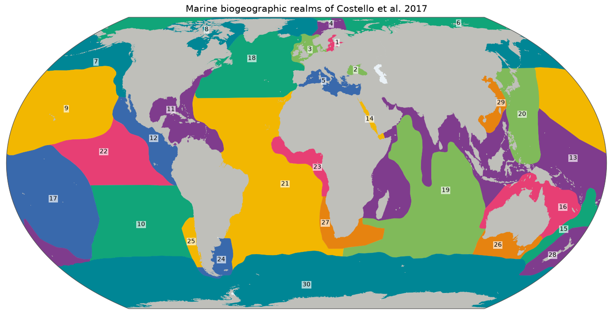

# Marine Biogeographic Realms (Costello et al. 2017)

Which animals and plants live in a stretch of sea depends on where it is: the species off Japan are not those off Peru. Biogeographers divide the ocean into *realms*, large regions with their own characteristic life. In 2017, Mark Costello and colleagues drew such a map from the data itself, by comparing where about 65,000 marine species have been recorded. The result is 30 realms that together cover the whole ocean.

*The 30 realms by number, drawn from [`overview.geojson`](overview.geojson). Colours only tell neighbours apart. Click for the [SVG](map.svg).*

## Sources and attribution

- **Costello, M.** (2017). *GIS shape files of realm maps.* The University of Auckland. Dataset. <https://doi.org/10.17608/k6.auckland.5596840.v1>. [CC BY 4.0](https://creativecommons.org/licenses/by/4.0/).
- **Costello, M.J., Tsai, P., Wong, P.S., Cheung, A.K.L., Basher, Z. & Chaudhary, C.** (2017). Marine biogeographic realms and species endemicity. *Nature Communications* 8: 1057. <https://doi.org/10.1038/s41467-017-01121-2>.

## How the shapes were made

The authors clustered the distributions of about 65,000 marine species from OBIS records on 5° grid cells, by Jaccard similarity, and drew 18 realms on continental shelves and 12 in the offshore deep sea. The shapes here are theirs and are unchanged, apart from conversion and simplification. The realms' borders in the open ocean are smooth, generalised lines, as the underlying grid is coarse.

The polygons also overlap land, since the realms were not clipped to a coastline. That doesn't matter here, as they are shipped as published. [`realm`](../realm/README.md), which clips them to the sea, does have to deal with it.

## Identifiers and names

Ids are the integer `Realm` value of the shapefile, 1 to 30, so `costello:13` is the Tropical Indo-Pacific & coastal Indian Ocean.

The shapefile has only these numbers. The English labels come from the finest column of the classification in Fig. 1 of the paper, with compass abbreviations spelled out (`NE Atlantic` becomes `North-east Atlantic`). Realm 8's long name, "N Atlantic boreal & sub-Arctic from Canada to Greenland Sea", is shortened. The names are in `REALM_NAMES` in the [build script](../scripts/costello/build.py).

## Technical details

- **Features:** 30, 0.5 MB, EPSG:4326, simplified with Douglas–Peucker at the repository's default of 0.005°.
- **Build:** [`scripts/costello/build.py`](../scripts/costello/build.py) reads `MarineRealms.shp` from the zip. The exact file and its hashes are in [`build.json`](build.json).
- **Backend:** `Gazetteer.COSTELLO`, pattern `^([1-9]|[12][0-9]|30)$`.
- **Reuse:** the same download feeds the 11 marine realms of [`realm`](../realm/README.md).

## References

- Costello et al. (2017), above, is the source of everything here.
- Spalding, M.D. et al. (2007). Marine Ecoregions of the World: a bioregionalization of coastal and shelf areas. *BioScience* 57: 573–583. <https://doi.org/10.1641/B570707>. The best-known alternative, whose licence rules out redistribution, which is why Costello's realms were chosen. See [`realm`](../realm/README.md).
- Ocean Biogeographic Information System (OBIS). <https://obis.org/>. The source of the species records behind the realms.
