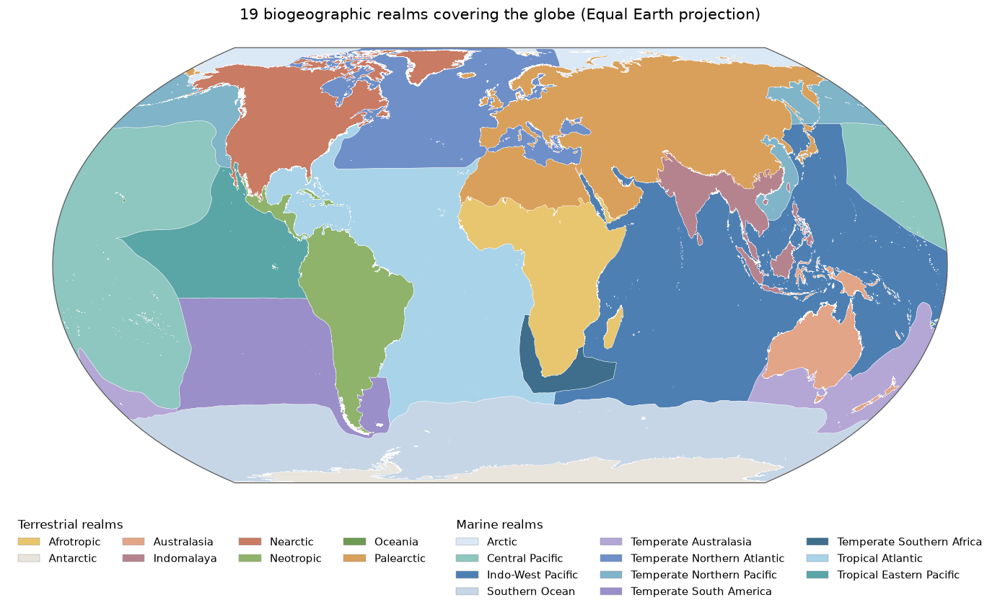

# The 19 biogeographic realms

The `realm` gazetteer divides the whole surface of the Earth, land and sea, into **19 biogeographic realms**: 8 terrestrial and 11 marine. Every point on the globe lies in exactly one of them. This note records how that set of realms and their shapes came about: which sources were used, which were rejected and why, and every judgement call made along the way. It is meant as the basis for a later Wikimedia Commons / Wikipedia contribution.



*Map: `realm/features/*.geojson`, rendered by [`realms-map.py`](realms-map.py).*

## The realms

Areas are geodesic (WGS 84) and add up to 510.06 million km², the surface of the Earth.

| Id | Realm | Type | Built from | Area (million km²) | Share |
|---|---|---|---|---:|---:|
| `Palearctic` | Palearctic | land | RESOLVE realm Palearctic | 53.22 | 10.4% |
| `Nearctic` | Nearctic | land | RESOLVE realm Nearctic | 22.72 | 4.5% |
| `Afrotropic` | Afrotropic | land | RESOLVE realm Afrotropic | 21.92 | 4.3% |
| `Neotropic` | Neotropic | land | RESOLVE realm Neotropic | 19.33 | 3.8% |
| `Antarctic` | Antarctic | land | RESOLVE realm Antarctica | 12.42 | 2.4% |
| `Australasia` | Australasia | land | RESOLVE realm Australasia | 9.23 | 1.8% |
| `Indomalaya` | Indomalaya | land | RESOLVE realm Indomalayan | 8.50 | 1.7% |
| `Oceania` | Oceania | land | RESOLVE realm Oceania | 0.05 | 0.0% |
| `IndoWestPacific` | Indo-West Pacific | sea | Costello 13, 14, 16, 19, 20 | 81.36 | 16.0% |
| `SouthernOcean` | Southern Ocean | sea | Costello 30 | 60.91 | 11.9% |
| `CentralPacific` | Central Pacific | sea | Costello 9, 17 | 56.09 | 11.0% |
| `TropicalAtlantic` | Tropical Atlantic | sea | Costello 11, 21, 23 | 52.23 | 10.2% |
| `TemperateNorthernAtlantic` | Temperate Northern Atlantic | sea | Costello 1, 2, 3, 4, 5, 8, 18 | 26.94 | 5.3% |
| `TemperateSouthAmerica` | Temperate South America | sea | Costello 10, 24, 25 | 25.98 | 5.1% |
| `TropicalEasternPacific` | Tropical Eastern Pacific | sea | Costello 12, 22 | 19.72 | 3.9% |
| `TemperateNorthernPacific` | Temperate Northern Pacific | sea | Costello 7, 29 | 13.48 | 2.6% |
| `TemperateAustralasia` | Temperate Australasia | sea | Costello 15, 26, 28 | 13.15 | 2.6% |
| `Arctic` | Arctic | sea | Costello 6 | 8.61 | 1.7% |
| `TemperateSouthernAfrica` | Temperate Southern Africa | sea | Costello 27 | 4.20 | 0.8% |

Land totals 147.4 million km² and sea 362.7 million km². The 8 terrestrial ids are the backend's long-standing `BioGeoRealm` values and are unchanged.

## 1. Terrestrial: the 8 WWF realms

The terrestrial realms are the 8 realms of the WWF *Terrestrial Ecoregions of the World* (Olson et al. 2001), in their current form: **RESOLVE Ecoregions 2017** (Dinerstein et al. 2017, CC BY 4.0). That dataset has 846 ecoregions, each carrying its realm, plus one realm-less "Rock and Ice" feature. A realm is the union of its ecoregions. Two spellings are adapted to the backend's ids: `Antarctica` → `Antarctic` and `Indomalayan` → `Indomalaya`.

## 2. Marine: looking for an equivalent

The aim was a marine counterpart at the same coarse level, keeping the whole set to roughly 20 entries. The reference picture was the familiar WWF marine realms map ([Wikimedia Commons](https://commons.wikimedia.org/wiki/File:Marine-biogeographical-realm.png)).

**MEOW / PPOW: not usable.** That map shows the 12 realms of *Marine Ecoregions of the World* (MEOW; Spalding et al. 2007). MEOW only covers coastal and shelf waters; the map maker extended the realms across the open ocean by hand. The published open-ocean companion is *Pelagic Provinces of the World* (PPOW; Spalding et al. 2012): 37 provinces in 4 pelagic realms. UNEP-WCMC distributes the two combined (WCMC036). Its *General Data License* forbids redistribution and sub-licensing, including of derivative works. COL asked UNEP-WCMC for permission to redistribute and was refused. A gazetteer without shapes is of no use, and redrawing or tracing MEOW's boundaries would still be a derivative work. So **no MEOW or PPOW geometry is used anywhere**, not even as a template. Only the names of the MEOW realms are borrowed, as labels.

**Other candidates considered:**

| Source | Units | Why not |
|---|---|---|
| Longhurst provinces | 54 | Defined by oceanography (light, mixing, productivity), not by species; also too fine. Already shipped as `longhurst`. |
| FAO major fishing areas | 19 | Administrative fisheries statistics areas. Already shipped as `fao`. |
| IHO sea areas / Marine Regions "Global Oceans and Seas" | ~100 / ~10 | Geographic, not biogeographic. |
| **Costello et al. 2017 marine realms** | 30 | **Chosen.** |

**Costello et al. 2017** delineated 30 marine realms by clustering the distributions of about 65,000 marine species (OBIS records on 5° cells, Jaccard similarity): 18 continental-shelf and 12 offshore deep-sea realms. Together they cover the whole ocean with no gaps. The shapefile is published on figshare under CC BY 4.0, which permits redistribution and derivatives with attribution. Being species-based, it also suits a taxonomic catalogue better than an expert-drawn or oceanographic scheme.

The 30 realms are shipped unchanged as the separate `costello` gazetteer. The shapefile has only numbers, so the names come from Fig. 1 of the paper, with compass abbreviations spelled out.

## 3. Grouping Costello's 30 realms into 11

30 marine realms are too many for this coarse level, so they are grouped into 11, each named after the MEOW realm it corresponds to. The grouping is COL's own.

| Marine realm | Costello realms |
|---|---|
| Arctic | 6 Arctic |
| Temperate Northern Atlantic | 1 Inner Baltic Sea, 2 Black Sea, 3 North-east Atlantic, 4 Arctic Europe, 5 Mediterranean, 8 North Atlantic boreal & sub-Arctic, 18 Offshore & North-west North Atlantic |
| Temperate Northern Pacific | 7 North Pacific, 29 North West Pacific |
| Tropical Atlantic | 11 Tropical West Atlantic, 21 Offshore South Atlantic, 23 Tropical East Atlantic |
| Tropical Eastern Pacific | 12 Tropical East Pacific, 22 Offshore mid-East Pacific |
| Central Pacific | 9 Mid-tropical North Pacific Ocean, 17 Mid South Tropical Pacific |
| Indo-West Pacific | 13 Tropical Indo-Pacific & coastal Indian Ocean, 14 Red Sea, 16 Tropical Australia & Coral Sea, 19 Offshore Indian Ocean, 20 Offshore West Pacific |
| Temperate South America | 10 South-east Pacific, 24 Argentina, 25 Chile |
| Temperate Southern Africa | 27 South Africa |
| Temperate Australasia | 15 Tasman Sea to South-west Pacific, 26 South Australia, 28 New Zealand |
| Southern Ocean | 30 Southern Ocean |

Decisions behind the grouping:

- **One Indo-West Pacific, not MEOW's Western and Central Indo-Pacific.** Costello's realm 13 runs from East Africa and the Arabian Sea across to the Coral Triangle, spanning both MEOW realms. Splitting it would mean drawing a boundary that is in neither source.
- **Central Pacific ≈ MEOW's Eastern Indo-Pacific.** Costello's two mid-ocean Pacific realms (9 around Hawaii, 17 across the south-central Pacific islands) form a realm of their own.
- **No separate open-ocean realms.** PPOW-style pelagic realms were considered and dropped. Each offshore Costello realm joins the coastal realm it adjoins: 18 → Temperate Northern Atlantic, 19 → Indo-West Pacific, 21 → Tropical Atlantic, 22 → Tropical Eastern Pacific.
- **Two borderline cases.** Realm 20 (Offshore West Pacific, about 0–40°N east of the Philippines and Japan) is mostly tropical, so it joins Indo-West Pacific rather than Temperate Northern Pacific. Realm 10 (South-east Pacific, open ocean at about 20–50°S) joins Temperate South America rather than becoming a realm of its own.

## 4. Making the realms cover the globe exactly once

Taken as published, the two sources neither tile the globe nor fit together:

- They are drawn on **different coastlines**. Costello's realms overlap land by about 2,750 square degrees, and elsewhere stop short of the shore.
- RESOLVE leaves **holes**: the lakes (Caspian, Great Lakes, Victoria, Baikal, …) and about 85,000 slivers between its simplified ecoregions. Its "Rock and Ice", covering the Greenland and Antarctic ice sheets and mountain glaciers, has **no realm at all**. As a result, the old 8 realms left all of inland Greenland and Antarctica unassigned.
- Costello stops at **89°N** and at **±179.99999°**, leaving a polar cap and a hairline gap along the antimeridian. RESOLVE stops at 89.89°S.

[`scripts/realm/partition.py`](../scripts/realm/partition.py) reconciles them in this order:

1. **Land wins over sea.** Land is everything RESOLVE covers, including rock & ice, with every hole filled. So lakes, enclosed river reaches and the slivers between ecoregions are land. Each terrestrial realm takes the holes it encloses on its own; for example, Baikal and the Caspian fall to the Palearctic.
2. **Rock & ice and lakes on a realm border** are cut into 5° tiles. Each tile goes to the terrestrial realm it shares the longest border with, which takes several passes for the interior of an ice sheet. In the current build that was 2,004 tiles. 195 of them, isolated ice-covered islets that touch no realm, went to the nearest one. As a result, **all of Greenland is Nearctic** (its ice-free ecoregions all are) and **the whole Antarctic continent is Antarctic**.
3. **Sea realms** are their Costello realms clipped to whatever land leaves, so the marine realms never cover land. The cap north of 89°N goes to the Arctic.
4. **Coastline mismatches** (water that is neither RESOLVE land nor Costello sea) are cut into tiles. Each tile goes to whichever realm, land or sea, it borders most: 2,171 tiles in the current build.
5. **Ice shelves are sea.** Costello already counts the Ross and Ronne ice shelves in its Southern Ocean. The smaller shelves it leaves out (Larsen, Amery, …; 99 tiles) go to the Southern Ocean too, so all floating ice is treated alike.
6. Vertices within 0.0001° of the antimeridian are **snapped onto ±180°**, so the hairline gap there doesn't join unrelated leftovers into one piece.
7. **Neighbours share their borders.** Rounding each realm to 6 decimals on its own left 1,077 hairline gaps and overlaps between 47 pairs of neighbours, and the two sides of a border did not run through the same vertices. Instead, all realm borders are snap-rounded together onto the 6-decimal grid into one network of edges, which cuts the globe into faces. Each face goes to the realm its interior lies in. Slivers that lie in no realm or in two go to the realm they border most; the current build has none. Each realm is the union of its faces, so neighbours are built from the very same edges. No realm moves by more than 0.00004 square degrees.

The build fails unless the result is an exact partition: valid polygons, no gap, no overlap, and every border shared by its two realms vertex for vertex, so that borders have no width (a valid polygonal coverage, in GEOS terms). It checks this exactly, with no tolerance.

## 5. Known limitations and open points

- **MEOW names, not MEOW boundaries.** The marine realms follow Costello's lines. For example, the Sargasso Sea falls in Temperate Northern Atlantic (Costello's offshore North Atlantic realm 18), whereas MEOW places Bermuda in the Tropical Atlantic.
- **Coarse marine boundaries.** Costello's realms were clustered from 5° cells, so open-ocean boundaries are smooth, generalised lines.
- **Indo-West Pacific** is a single realm (see §3).
- **Ice shelves** are counted as Southern Ocean. If they should belong to Antarctica, an ice-shelf outline is needed (e.g. Natural Earth's public-domain Antarctic ice shelves), because Costello draws Ross and Ronne as sea.
- **Endorheic lakes** such as the Caspian and Aral count as lakes, so they are land (Palearctic).
- **Oceania** is tiny (0.05 million km²): it consists only of the Pacific islands RESOLVE assigns to it.
- **Resolution.** Inputs are simplified at 0.005° (about 550 m) before partitioning, like every gazetteer in this repo.

## 6. Towards Wikimedia Commons and Wikipedia

- **Licence.** Both geometry sources are CC BY 4.0, so the map and the realm polygons can be released under CC BY 4.0, crediting RESOLVE / Dinerstein et al. 2017, Costello et al. 2017 and the Catalogue of Life.
- **File format.** Commons prefers SVG for maps. `uv run docs/realms-map.py realms.svg` writes one; labels and colours may still want work.
- **Citability.** The grouping of Costello's realms and the reconciliation rules are COL's own. Before a Wikipedia article can rely on them, they would need a citable publication, for example a versioned dataset release with a DOI, rather than this repository alone.

## Sources

- Dinerstein, E., Olson, D., Joshi, A. et al. (2017). An Ecoregion-Based Approach to Protecting Half the Terrestrial Realm. *BioScience* 67 (6): 534–545. <https://doi.org/10.1093/biosci/bix014>. Data: RESOLVE Ecoregions 2017, CC BY 4.0, <https://ecoregions.appspot.com/>
- Olson, D.M. et al. (2001). Terrestrial Ecoregions of the World: A New Map of Life on Earth. *BioScience* 51 (11): 933–938.
- Costello, M.J., Tsai, P., Wong, P.S., Cheung, A.K.L., Basher, Z. & Chaudhary, C. (2017). Marine biogeographic realms and species endemicity. *Nature Communications* 8: 1057. <https://doi.org/10.1038/s41467-017-01121-2>. Data: Costello, M. (2017). GIS shape files of realm maps. The University of Auckland. CC BY 4.0. <https://doi.org/10.17608/k6.auckland.5596840.v1>
- Spalding, M.D. et al. (2007). Marine Ecoregions of the World: a bioregionalization of coastal and shelf areas. *BioScience* 57: 573–583. <https://doi.org/10.1641/B570707> (names only; no geometry used)
- Spalding, M.D., Agostini, V.N., Rice, J. & Grant, S.M. (2012). Pelagic provinces of the world: a biogeographic classification of the world's surface pelagic waters. *Ocean & Coastal Management* 60: 19–30. <https://doi.org/10.1016/j.ocecoaman.2011.12.016> (considered, not used)

## Reproducing

```sh
scripts/.venv/bin/python scripts/costello/build.py   # the 30 Costello realms
scripts/.venv/bin/python scripts/realm/build.py      # the 19 realms (~4 min)
uv run docs/realms-map.py                            # this map
```
