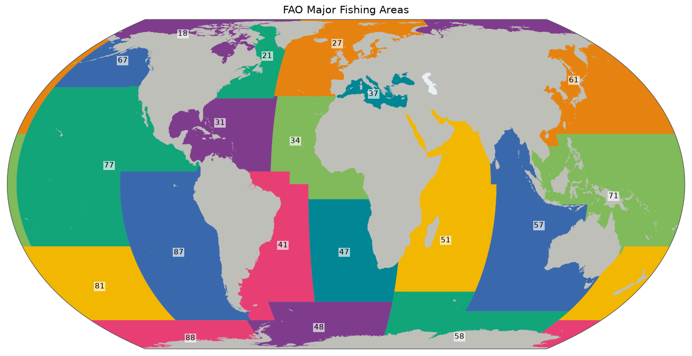

# FAO Major Fishing Areas

To report the world's fish catches in a comparable way, the Food and Agriculture Organization of the United Nations (FAO) divides the waters of the world into numbered statistical areas. Area 37 is the Mediterranean and Black Sea, for example, and area 61 the Northwest Pacific. These numbers are used worldwide in fisheries statistics, and so also in species checklists, which is why a catalogue of life needs them. This gazetteer has the 19 marine major areas and the smaller areas within them.

*The 19 major areas, drawn from [`overview.geojson`](overview.geojson). Colours only tell neighbours apart. Click for the [SVG](map.svg).*

## Sources and attribution

- **FAO.** *FAO statistical areas (Marine)*, Fisheries Global Information System (FIGIS) GeoServer, layer [`fifao:FAO_AREAS_NOCOASTLINE`](https://www.fao.org/fishery/geoserver/fifao/ows?service=WFS&version=2.0.0&request=GetCapabilities). Licence: [CC BY 4.0](https://creativecommons.org/licenses/by/4.0/), under the [FAO database terms](https://www.fao.org/contact-us/terms/db-terms-of-use/en/), which also say that datasets may not be used to promote a commercial enterprise, or in a way that suggests FAO's endorsement.

Cite as: *FAO. Fisheries Global Information System: FAO statistical areas (Marine). Accessed on `built_at`. https://www.fao.org/fishery/en/area. Licence: CC-BY-4.0.* The date is in [`build.json`](build.json), along with the exact URL and hashes.

## How the shapes were made

The shapes are FAO's own and are unchanged, apart from conversion and simplification. The build requests FAO's master layer "not erased by coastline": its polygons run across land instead of following a coast, so that they can be used with any coastline. The map draws land on top of them for that reason.

The build only takes records with `F_STATUS='endorsed'` and an English name, which leaves out unstable draft breakdowns, such as two options for Area 31 that were still pending.

## Identifiers and names

Ids are FAO's own `F_CODE`, which encode the hierarchy of the CWP Handbook. They are case-sensitive, as sub-units can use letters.

| Level | Example | Areas |
|---|---|---:|
| Major area | `37` Mediterranean and Black Sea | 19 |
| Subarea | `88.1` | 70 |
| Division | `37.4.1` Sea of Marmara | 200 |
| Subdivision | `21.3.P.n` | 55 |
| Subunit | `27.3.d.28.1` Gulf of Riga | 4 |

[`labels.tsv`](labels.tsv) carries FAO's English label, and adds its French and Spanish labels as extra columns, which the backend ignores. Below the major areas, FAO's English labels are compact and technical (`Atlantic, Northwest / 21.0`).

## Technical details

- **Features:** 348, 0.4 MB, EPSG:4326, simplified with Douglas–Peucker at the repository's default of 0.005°.
- **Build:** [`scripts/fao/build.py`](../scripts/fao/build.py).
- **Overview and map:** the 19 major areas only, as the rest are nested inside them.
- **Backend:** `Gazetteer.FAO`, which is case-sensitive, with the pattern `^[0-9]{2}(?:\.(?:[0-9]+|[A-Z])(?:\.(?:[0-9]+|[A-Za-z])){0,3})?$`. Areas link to `https://www.fao.org/fishery/en/area/{id}`.

## References

- FAO. *CWP Handbook of Fishery Statistics: Fishing areas for statistical purposes.* <https://www.fao.org/cwp-on-fishery-statistics/handbook/general-concepts/fishing-areas-for-statistical-purposes>. The definition of the areas and their codes.
- Flanders Marine Institute (VLIZ). *Marine Regions.* <https://www.marineregions.org/>. Republishes the major areas as its `fao` layer. An earlier build read them from there, but that layer has only the 19 major areas, while species distributions also cite the levels below, so the source moved to FAO itself. The major areas also exist in [`mrgid`](../mrgid/README.md).
