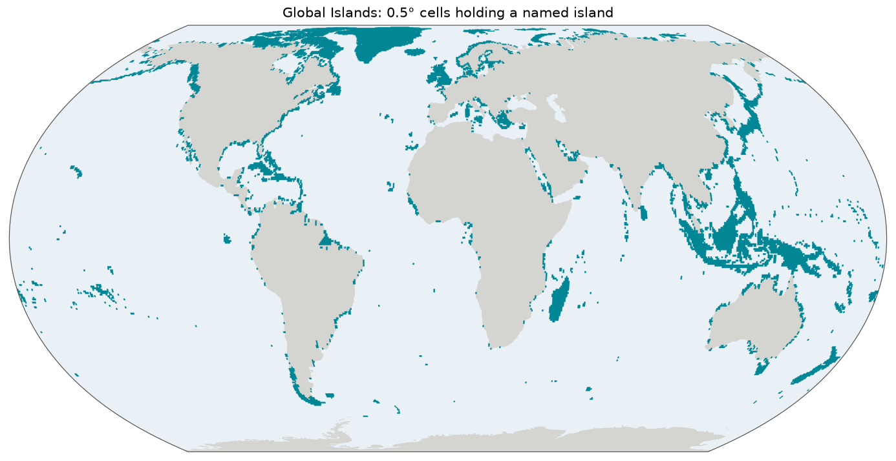

# Global Islands

Islands are where evolution has often taken its own course, so species lists often name an individual island: Socotra, Tasmania, Lord Howe. This gazetteer gives named islands an outline. It is based on *Global Islands*, a global inventory of about 370,000 islands drawn from 30 m satellite imagery by the U.S. Geological Survey with Esri and UNEP-WCMC. From it we take the islands larger than 1 km² that have a name of their own: 15,139 in all.

*15,139 islands are too many to show one by one, so the map shows the 0.5° grid cells that hold one, drawn from [`overview.geojson`](overview.geojson). 7,332 unnamed big islands are left out, among them most of the largest in the Antarctic. Click for the [SVG](map.svg).*

## Sources and attribution

- **Sayre, R.** (2023). *Global Islands.* U.S. Geological Survey data release. <https://doi.org/10.5066/P91ZCSGM>. U.S. public domain: the FGDC metadata records access and use constraints as "none", and the GEO Knowledge Hub package records it as CC BY 4.0.
- **Sayre, R., Noble, S., Hamann, S. et al.** (2018). A new 30 meter resolution global shoreline vector and associated global islands database for the development of standardized ecological coastal units. *Journal of Operational Oceanography* 12 (sup2): S47–S56. <https://doi.org/10.1080/1755876X.2018.1529714>.

USGS and Esri produced the shoreline, from 2014 Landsat composites, and the island polygons. UNEP-WCMC contributed an earlier island layer, from which most of the upstream names come. The file is [ArcGIS Online item `885a860af66d4833887dcce735a521a7`](https://www.arcgis.com/home/item.html?id=885a860af66d4833887dcce735a521a7), v3, because the 1.5 GB package of the USGS release needs a manual download request. The exact URL and hashes are in [`build.json`](build.json).

## How the shapes were made

The shapes are the source's, apart from conversion and simplification. Two deliberate choices decide what is included:

- **Size.** Only the `BigIslands` layer, over 1 km². Smaller islands are below what a regional checklist works at, and their names are mostly unusable: there are 23 separate "Round Island"s. The `Mainlands` layer, the continents, has neither names nor ids, and [`continent`](../continent/README.md) covers them.
- **Name.** Only islands with a USGS name are included. See below.

## Identifiers and names

Ids are `ALL_Uniq`, documented upstream as unique across all size classes. `USGS_ISID` is not, as it is per polygon. So `gi:281836` is Greenland.

Labels come from `Name_USGSO` only, compiled per island by USGS against Google Earth. This is the decision that shaped the gazetteer. The other name columns, `NAME_wcmcI` and `NAME_LOCAL`, were transferred from the older UNEP-WCMC layer by a nearest-neighbour join, whose residue is still visible in the `NEAR_FID`, `NEAR_DIST` and `Meaning_AL` columns. Islets inherited the name of the large island beside them: accepting any non-empty name would give 2,768 features called "Baffin Island", 805 "Iceland" and 657 "Cuba". The dataset's own join flag does not separate good from bad, marking only 43% of the known-bad cases.

A plain "is not empty" test does not work either. Absent names are a single space, and 6,659 big islands carry the literal name `UNNAMED`. The build tests for all of these explicitly.

Many names are still shared by several islands, as in reality. 78% of the features are uniquely named. The 7,332 big islands left out for want of a name, the largest of them 52,223 km², are reported to `work/gi/unnamed-big-islands.tsv` at build time.

## Technical details

- **Features:** 15,139 in EPSG:4326: 22 MB of JSON, but about 71 MB allocated on a filesystem with 4 KB blocks.
- **Simplification:** Douglas–Peucker at 0.002°, overriding the repository's 0.005°, which is tuned for large smooth regions and not for islands. For all 22,047 features carrying any name, with the share left with 4 coordinates or fewer, a triangle or less:

  | Tolerance | Real-world | Size | Degenerate |
  |---|---|---|---|
  | `0.0005°` | ~55 m | 92.5 MB | 0% |
  | `0.001°` | ~110 m | 52.5 MB | 0% |
  | **`0.002°`** | **~220 m** | **31.5 MB** | **0.1%** |
  | `0.005°` | ~550 m | 17.2 MB | 6.4% |

  For the record, the size classes below 1 km² behave differently, and coarsening them saves almost nothing: `VerySmallIslands` shrinks by 0.7 MB between `0.0001°` and `0.005°`, while going from 9% to 99% degenerate.
- **Build:** [`scripts/gi/build.py`](../scripts/gi/build.py). The 818 MB zip is unpacked rather than read through `/vsizip/`, as OpenFileGDB seeks across its tables, which through a deflated zip member means repeated decompression. OGRSQL has no `TRIM()`, which is why the filter names the blank values one by one.
- **Overview and map:** a coverage overview, one MultiPolygon of 0.5° grid cells.
- **Backend:** `Gazetteer.GI`, pattern `^[0-9]+$`. No link template, as the [Global Island Explorer](https://apps.usgs.gov/glbeco/gie.html), the browser app over this data, has no documented link per island. Cite the data release rather than that app.

The full reasoning is in the [design note](../docs/superpowers/specs/2026-09-08-gi-gazetteer-design.md).

## References

- Sayre (2023) and Sayre et al. (2018), above.
- UNEP-WCMC. *Global Islands Database.* The predecessor of this product, recognisable by its `ID_GID` column, whose name columns are not trusted here for the reasons above.
