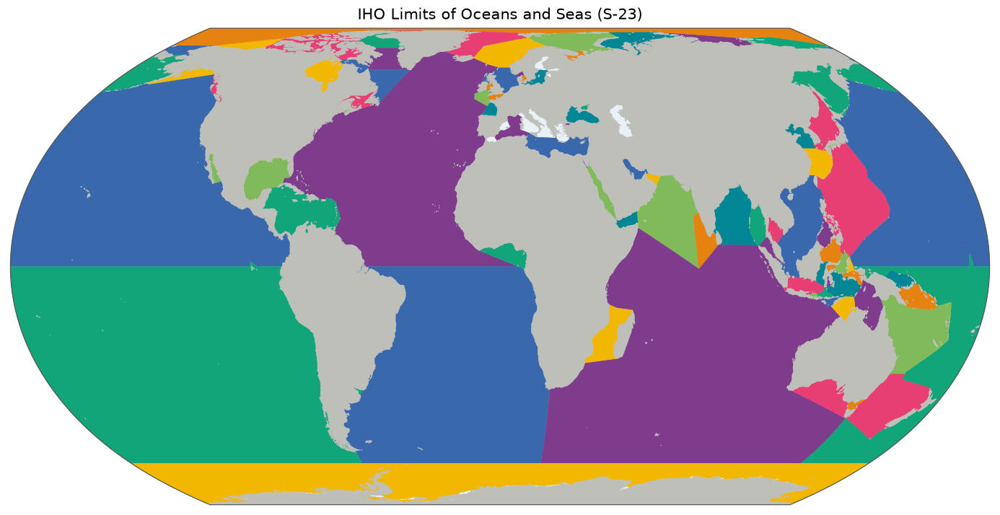

# IHO Sea Areas (Limits of Oceans and Seas)

Where does the North Sea end and the Atlantic begin? Sailors need an agreed answer, and so do scientists who record what lives where. The International Hydrographic Organization (IHO) publishes it in *Limits of Oceans and Seas*, known as S-23: a numbered list of the world's seas, each with its limits described in words. The Flanders Marine Institute turned those descriptions into a map, and this gazetteer uses the same numbers.

*The sea areas, drawn from [`overview.geojson`](overview.geojson). Colours only tell neighbours apart. Click for the [SVG](map.svg).*

## Sources and attribution

- **Flanders Marine Institute (VLIZ).** *IHO Sea Areas*, version 3, MarineRegions.org, WFS layer [`MarineRegions:iho`](https://geo.vliz.be/geoserver/MarineRegions/ows?service=WFS&version=2.0.0&request=GetFeature&typeNames=MarineRegions:iho&outputFormat=application/json). <https://doi.org/10.14284/323>. [CC BY 4.0](https://creativecommons.org/licenses/by/4.0/). Cite as: *Flanders Marine Institute (VLIZ). MarineRegions.org. Consulted on `built_at`.* The date is in [`build.json`](build.json), along with the exact URL and hashes.
- **International Hydrographic Organization** (1953). *Limits of Oceans and Seas*, Special Publication No. 23, 3rd edition. Monaco. The definition of the areas, kept here as [`S23_1953.pdf`](S23_1953.pdf).

## How the shapes were made

The polygons are VLIZ's digitisation of the S-23 descriptions, unchanged apart from conversion and simplification. The zipped shapefile on marineregions.org is behind a form, so the build uses the public WFS service, which returns the same dataset as GeoJSON.

## Identifiers and names

Ids are the area numbers printed in S-23, because this is how species distributions cite them. VLIZ's own MRGID is kept as a property inside each feature for cross-reference, and the same areas also exist in [`mrgid`](../mrgid/README.md).

**Case matters.** S-23 distinguishes `28A` (Mediterranean Sea, Western Basin) from `28a` (Strait of Gibraltar). An uppercase suffix marks a peer, as `28A` and `28B` are the two Mediterranean basins, while a lowercase one marks a sub-area, as in `1a`, the Gulf of Bothnia in `1`, the Baltic Sea. Because of this, the tree must live on a case-sensitive filesystem.

## Technical details

- **Features:** 101, 38 MB, EPSG:4326, simplified with Douglas–Peucker at the repository's default of 0.005°. They are large for their number, as they follow every coast in detail.
- **Overview and map:** areas without a lowercase suffix, as the others are nested inside them. The exception is area 48, the East Indian Archipelago, which only exists as its sub-areas `48a` to `48o` and would otherwise be a hole in the map.
- **Build:** [`scripts/iho/build.py`](../scripts/iho/build.py).
- **Backend:** `Gazetteer.IHO`, case-sensitive, with the pattern `^[0-9]+[a-zA-Z]?$`.

## References

- IHO (1953), above. A 4th edition was drafted in 2002 but never approved, so the 1953 edition remains in force. Its seas reflect the geography and the naming of its time.
- Claus, S., De Hauwere, N., Vanhoorne, B. et al. (2014). Marine Regions: Towards a Global Standard for Georeferenced Marine Names and Boundaries. *Marine Geodesy* 37 (2): 99–125. <https://doi.org/10.1080/01490419.2014.902881>. The project behind the digitised version.
