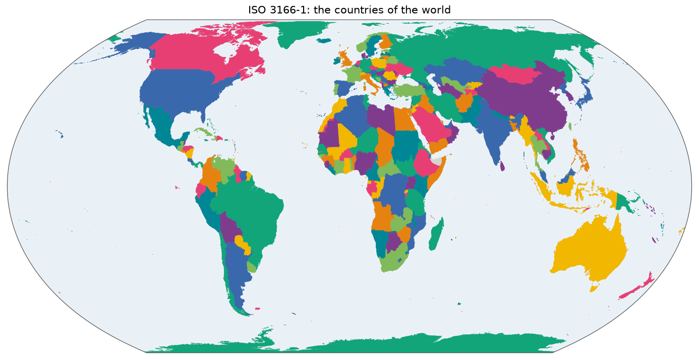

# ISO 3166: countries and their subdivisions

Almost everyone has used ISO 3166 without knowing it: `DE` for Germany and `US` for the United States are its country codes, and `US-CA` for California is one of its subdivision codes. It's the international standard for naming countries, and the most common way to say where a species occurs. The standard itself has only the codes and names. This gazetteer adds a shape to each of them.

*The 250 countries, drawn from [`overview.geojson`](overview.geojson). Colours only tell neighbours apart. Click for the [SVG](map.svg).*

## Sources and attribution

- **Natural Earth**, by Tom Patterson and Nathaniel Vaughn Kelso. Public domain. [`ne_10m_admin_0_countries`](https://naciscdn.org/naturalearth/10m/cultural/ne_10m_admin_0_countries.zip), [`ne_10m_admin_0_map_subunits`](https://naciscdn.org/naturalearth/10m/cultural/ne_10m_admin_0_map_subunits.zip) and [`ne_10m_admin_1_states_provinces`](https://naciscdn.org/naturalearth/10m/cultural/ne_10m_admin_1_states_provinces.zip). Made with Natural Earth. This is the source of most shapes.
- **OpenStreetMap**, © [OpenStreetMap contributors](https://www.openstreetmap.org/copyright), [ODbL 1.0](https://opendatacommons.org/licenses/odbl/). Queried through [Overpass](https://overpass-api.de/) for 45 countries. Features whose `properties.source` starts with `osm-overpass`, also listed in [`sources.tsv`](sources.tsv), are derived from OpenStreetMap and stay under the ODbL.
- **Wikidata**, [CC0](https://creativecommons.org/publicdomain/zero/1.0/). Which codes exist, what they belong to and where they lie.

Every source, with its query hash or file hash, is in [`build.json`](build.json).

## How the shapes were made

The base is Natural Earth, which covers countries and many subdivisions. It doesn't ship all that legacy and current data uses, so a series of passes in [`build.py`](../scripts/iso/build.py) add the rest:

1. **Gaps in the countries.** Where Natural Earth has `ISO_A2 = -99`, `ISO_A2_EH` in the map subunits fills in. 250 of the 251 codes of the backend's enumeration are covered. Only `XZ`, international waters, has no shape.
2. **Dual-coded territories**, such as `FR-PM`, `US-AS`, `NL-AW` and `FI-01`, are symlinks to the standalone country ([`fr_aliases.py`](../scripts/iso/fr_aliases.py)).
3. **Clipperton**, `FR-CP`, is a small synthetic polygon.
4. **Dissolved regions**, built by merging the units Natural Earth does have: the 13 current French régions (`FR-ARA`, `FR-IDF`, …) and the 22 from before 2016 (`FR-A` … `FR-V`), the 4 UK home nations (`GB-ENG`, `GB-SCT`, `GB-WLS`, `GB-NIR`) and the 17 Spanish autonomous communities.
5. **Every other ISO 3166-2 code Wikidata knows.** A code that one successor replaced 1:1 becomes a symlink to it (`IN-DD` → `IN-DH`). The others begin as a 32-sided **placeholder circle** of 0.5° radius, at the place's Wikidata coordinates, or at the centroid of its country if it has none.
6. **Real OSM polygons replace placeholders** wherever OpenStreetMap has an administrative relation tagged with the same `ISO3166-2` code. The build queries every country with at least 5 placeholders, 45 of them. Match rates range from 100% (Bangladesh, Kenya, Lithuania, North Macedonia, Uganda) to 0% (Bosnia and Herzegovina, Georgia, Palestine), as OSM's relations there don't carry the codes.
7. **Historic ISO 3166-3 codes** that legacy data still uses: `YU` Yugoslavia, dissolved from its successors, `AN` Netherlands Antilles, dissolved from `CW`, `SX` and `BQ`, and `TP` East Timor, a symlink to `TL`. Also the legacy aliases `BQ-BO` and `BQ-SA`.

`LABEL_OVERRIDES` corrects the few Natural Earth labels that disagree with ISO, such as `US-DC`, "Washington" in Natural Earth.

So **not every shape is a real outline**: 325 of them are still placeholder circles. Check [`sources.tsv`](sources.tsv) before relying on a subdivision's shape:

| `resolution` | Features | What it is |
|---|---:|---|
| `upstream` | 5,424 | Direct from a Natural Earth layer or OSM |
| `placeholder-circle` | 300 | 0.5° radius circle at the Wikidata coordinates |
| `dissolved` | 58 | Merged from sub-divisions, such as `GB-ENG` from 152 |
| `placeholder-country-centroid` | 25 | The same circle, at the country's centroid |
| `alias-symlink` | 21 | Relative symlink to another id's file |
| `alias-symlink-superseded` | 5 | Symlink to the code that replaced this one |
| `upstream-relabel` | 1 | Upstream shape, with a corrected label |
| `synthetic` | 1 | Hand-drawn polygon, `FR-CP` |

## Identifiers and names

Ids are upper-case ISO codes: `US`, `US-CA`, `FR-ARA`, and the historic `YU`. Features without a valid ISO code, including Natural Earth's non-ISO territories marked `-99` and subdivisions in disputed areas with an empty code, are skipped.

Country and subdivision labels are English, from Natural Earth, Wikidata or `LABEL_OVERRIDES`.

Borders and names in Natural Earth follow its own policy of showing the de facto situation, and don't express a position of the Catalogue of Life on any territorial dispute.

## Technical details

- **Features:** 5,835 (250 countries, 3 historic countries and 5,582 subdivisions), 37 MB, EPSG:4326, simplified with Douglas–Peucker at the repository's default of 0.005°, and with shapely for OSM shapes.
- **`sources.tsv`:** one row per id with `id`, `resolution`, `upstream`, `target` and `note`. `upstream` is the `properties.source` tag of the geometry, for a symlink that of its target, and `target` is only set for symlinks. `note` holds context such as "ISO 3166-3, withdrawn 2003". The backend ignores this file. It's generated and committed so that changes can be reviewed.
- **Caches:** Wikidata results and OSM responses are cached under `sources/iso/`, and the hash of each query is recorded in `build.json`.
- **Overview and map:** the countries, without `YU`, `AN` and `TP`, which overlap their successors.
- **Build:** [`scripts/iso/build.py`](../scripts/iso/build.py), with [`osm_augment.py`](../scripts/iso/osm_augment.py) and [`wikidata_augment.py`](../scripts/iso/wikidata_augment.py).
- **Backend:** `Gazetteer.ISO`, pattern `^[A-Z]{2}(-[A-Z0-9]{1,6})?$`. The backend has its own ISO 3166-1 table of names, and reads subdivision labels from here.

## References

- International Organization for Standardization. *ISO 3166: Codes for the representation of names of countries and their subdivisions.* <https://www.iso.org/iso-3166-country-codes.html>. The definition of the codes, in parts 1 (countries), 2 (subdivisions) and 3 (formerly used codes). The codes themselves come through the sources above, not from a copy of the standard.
- Natural Earth. *Disputed boundaries policy.* <https://www.naturalearthdata.com/about/disputed-boundaries-policy/>.
