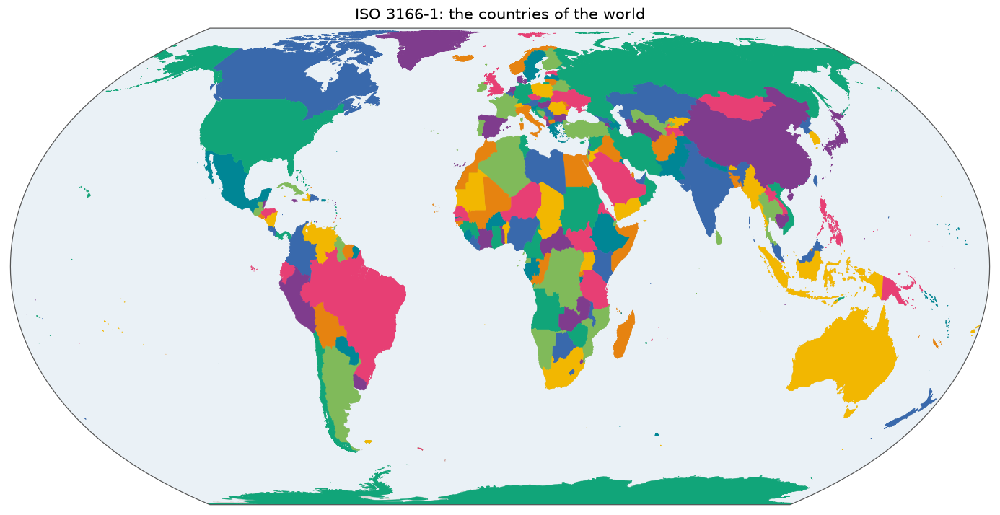
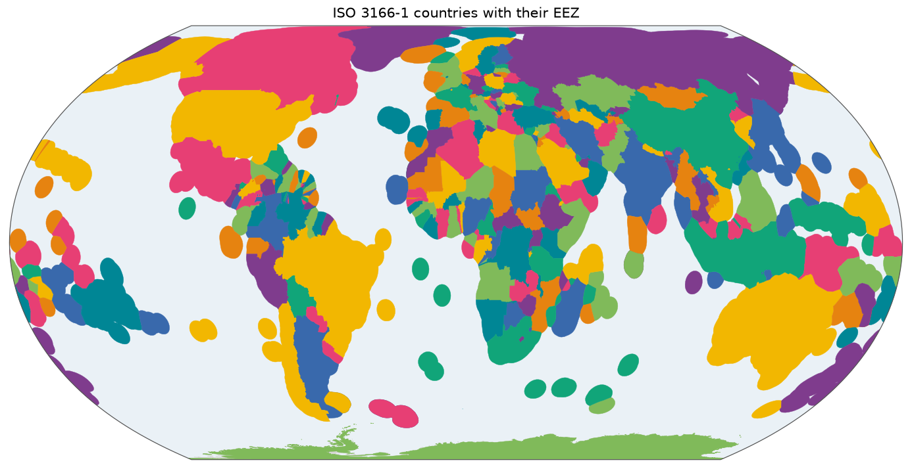

# ISO 3166: countries and their subdivisions

Almost everyone has used ISO 3166 without knowing it: `DE` for Germany and `US` for the United States are its country codes, and `US-CA` for California is one of its subdivision codes. It's the international standard for naming countries, and the most common way to say where a species occurs. The standard itself has only the codes and names. This gazetteer adds a shape to each of them.

The countries are the ones [GBIF](https://www.gbif.org/) uses to tell which country an occurrence lies in, so `iso:NO` means the same area in the Catalogue of Life as in GBIF. Each country has two shapes under the same id:

- **land**, the default, shown below;
- **land + EEZ**, the country together with its exclusive economic zone, for marine and fisheries data. The ChecklistBank API is to serve it with `?variant=eez`, as in `/vocab/area/iso:NO.geojson?variant=eez`. A subdivision has only its land shape, which the API serves for both.

*The 250 countries on land, drawn from [`overview.geojson`](overview.geojson). Colours only tell neighbours apart. Click for the [SVG](map.svg).*

*The same countries with their EEZ, from [`eez/overview.geojson`](eez/overview.geojson).*

## Sources and attribution

- **Flanders Marine Institute (2024).** *Union of the ESRI Country shapefile and the Exclusive Economic Zones (version 4).* <https://doi.org/10.14284/698>. [CC BY 4.0](https://creativecommons.org/licenses/by/4.0/). The country areas, as the file `EEZ_land_union_v4_202410.zip` that GBIF imports. Marine Regions asks that their files are not offered for download elsewhere, so the build takes it from GBIF's mirror, or from a private copy, and only the shapes made from it are published here.
- **Flanders Marine Institute (2023).** *Maritime Boundaries Geodatabase: Maritime Boundaries and Exclusive Economic Zones (200NM), version 12.* <https://doi.org/10.14284/632>. [CC BY 4.0](https://creativecommons.org/licenses/by/4.0/). The EEZ water that is taken away to leave the land, as `eez_v12.gpkg` from the same mirror.
- **GBIF's changes**, replayed from `import_political()` in [`gbif/geocode`](https://github.com/gbif/geocode/blob/6a578ecefde0/database/import.sh) at commit `6a578ecefde0`, and GBIF's [country list](https://api.gbif.org/v1/enumeration/country) to turn three-letter codes into two-letter ones.
- **OpenStreetMap**, © [OpenStreetMap contributors](https://www.openstreetmap.org/copyright), [ODbL 1.0](https://opendatacommons.org/licenses/odbl/). Subdivisions first, as published by [Overture Maps](https://overturemaps.org/) in its divisions theme, and the areas GBIF's changes take from OSM (Kosovo, Hong Kong, Macao, Åland, Kinmen and Matsu, the Scheldt near Antwerp). Features whose `properties.source` starts with `osm-relation` are derived from OpenStreetMap and stay under the ODbL.
- **Natural Earth**, by Tom Patterson and Nathaniel Vaughn Kelso. Public domain. [`ne_10m_admin_1_states_provinces`](https://naciscdn.org/naturalearth/10m/cultural/ne_10m_admin_1_states_provinces.zip), for subdivisions OSM lacks. Made with Natural Earth.
- **geoBoundaries** (Runfola et al. 2020), for a few former units, such as Albania's districts. Each country's layer has its own licence, named in the `note` of its rows in [`sources.tsv`](sources.tsv).
- **Wikidata**, [CC0](https://creativecommons.org/publicdomain/zero/1.0/). Which ISO 3166-2 codes exist, their English names, coordinates, successors and linked OSM relations.

Every source, with its hash, is in [`build.json`](build.json).

## How the shapes were made

### Countries

GBIF's geocoder takes the union of countries and EEZs by Marine Regions and changes it in a few places. [`political.py`](../scripts/iso/political.py) replays those changes in GBIF's order:

1. Antarctica gets `AQ`, and a cap over the pole.
2. Kinmen and Matsu move from China to Taiwan.
3. Kosovo, Hong Kong, Macao, Åland and Midway become areas of their own, cut out with their OSM boundary or, for Midway, a hand-drawn polygon.
4. The Netherlands–Belgium border near Antwerp follows OSM.
5. The South China Sea claim, and joint regimes that only repeat an EEZ, are dropped.
6. Missing codes are filled in from the sovereign, and a few are corrected: Chagos, Tromelin, Matthew and Hunter, Navassa, Ukraine.

An area then counts for **every** country it names. So disputed areas belong to each claimant, and their shapes overlap:
- Western Sahara: `EH` and `MA`;
- the Falklands and South Georgia: `FK`, `GS` and `AR`;
- Palestine: `PS` and `IL`;
- the southern Kurils: `RU` and `JP`;
- the Hala'ib Triangle: `EG` and `SD`;
- Mayotte: `YT` and `KM`.

A country's **land + EEZ** shape is the union of its areas. Its **land** shape is the same areas without the EEZ water, so it always lies within land + EEZ. ESRI's coastline misses some atolls and small islands. Where a subdivision source has such an island inside the country's EEZ, it is added to the land (see below).

The historic codes `YU` (Yugoslavia) and `AN` (Netherlands Antilles) are merged from their successors, and `TP` (East Timor) points to `TL`.

These definitions differ from Natural Earth's, which this gazetteer used until November 2026. That last build is kept under the git tag [`pre-iso-gbif`](https://github.com/CatalogueOfLife/col-gazetteers/tree/pre-iso-gbif/iso). The main differences:
- `FR` no longer includes French Guiana, Guadeloupe, Martinique, Réunion and Mayotte.
- `NO` no longer includes Svalbard, `NL` the Caribbean Netherlands, and `IT` the Vatican. All of them keep their own codes.
- Crimea is part of `UA`, the Golan Heights of `SY`, and the Ilemi Triangle of `SS`.

These follow GBIF and Marine Regions. They don't express a position of the Catalogue of Life on any territorial dispute.

### Subdivisions

Each subdivision takes the first source that has its code, in this order:
1. an OpenStreetMap boundary, taken from Overture Maps' divisions and matched to the code by Overture's own ISO 3166-2 code for top-level regions, by the OSM relation the code's Wikidata item links to, or by the Wikidata item itself, in that order;
2. Natural Earth;
3. geoBoundaries;
4. a union of other codes' shapes, such as `GB-GBN` from England, Scotland and Wales;
5. a placeholder circle, 0.5° around Wikidata's coordinates or inside its country.

It is then fitted into its country, clipped to the land of the country and of the territories ISO also codes under it (`FR-GF` lies in `GF`). [`fit.py`](../scripts/iso/fit.py) does this in three passes:
1. **Land.** It takes the first real source of which at least 10% lies on that land.
2. **Land + EEZ.** If none does, it takes the first real source of which at least 10% lies in the land + EEZ, and adds what is kept to the country's land. This catches atolls and islands that ESRI's coastline misses.
3. **Placeholder.** Otherwise the placeholder circle, clipped however small.

If nothing fits, the shape is kept unclipped and marked `conflict` in `sources.tsv`, with the country whose area holds it. The current build has none.

Codes that ISO also gives a country, such as `FR-GF`, `US-PR`, `CN-TW` or `FI-01`, are links to that country's file in both sets. Withdrawn codes that one successor replaced, such as `IN-DD` → `IN-DH`, are links to their successor.

| `resolution` | Ids | What it is |
|---|---:|---|
| `osm` | 4,700 | an OSM boundary, through Overture Maps |
| `natural-earth` | 620 | Natural Earth admin 1 |
| `geoboundaries` | 67 | geoBoundaries |
| `derived` | 13 | a union of other codes' shapes |
| `placeholder-circle` | 108 | a circle around Wikidata's coordinates |
| `placeholder-country-centroid` | 20 | a circle inside the country, for codes without coordinates |
| `alias-dual` | 36 | a link to the country ISO also codes it as |
| `alias-superseded` | 17 | a link to the one code that replaced it |
| `alias-legacy` | 3 | a link kept from earlier builds: `TP`, `BQ-BO`, `BQ-SA` |
| `dissolved` | 2 | `YU` and `AN`, merged from their successors |

Overture has no OSM boundary that can be matched for most council areas of the United Kingdom, the municipalities of North Macedonia, and the regional units of Greece, so these come from Natural Earth or geoBoundaries.

## Identifiers and names

Ids are upper-case ISO codes: `US`, `US-CA`, `FR-ARA`, and the historic `YU`. Every id an earlier build published stays, because data in ChecklistBank may use it. New ids come only from Wikidata, when they match the backend's pattern `^[A-Z]{2}(-[A-Z0-9]{1,6})?$`.

Labels are English. An id keeps the label it was first published with. A new id takes Wikidata's English name, else the name of its source. `LABEL_OVERRIDES` in [`universe.py`](../scripts/iso/universe.py) corrects a label on purpose.

## Technical details

- **Features:** 5,836 in `features/` (252 countries including `YU` and `AN`, 5,528 subdivisions, 56 links) and 289 in `eez/features/`. EEZ shapes exist for the countries, `YU`, `AN`, and the links that lead to a country. Everything is EPSG:4326, simplified with Douglas–Peucker at 0.005°. The backend's country list also has `XZ`, international waters, which has no shape here.
- **`sources.tsv`:** one row per id, with these columns:
  - `id`;
  - `resolution`: the table above, and for countries `gbif-political`;
  - `upstream`: `properties.source` of the feature, or for a country the areas it is made of;
  - `target`: the file a link points to;
  - `fit`: `land`, `eez` or `conflict`;
  - `note`.

  The backend ignores it. It's generated and committed so that changes can be reviewed.
- **Conflicts:** none in the current build. They would be the rows whose `fit` is `conflict` in `sources.tsv`.
- **Overview and maps:** the countries, without `YU`, `AN` and `TP`, which overlap their successors, for both sets.
- **Build:** [`build.py`](../scripts/iso/build.py), monthly in its own workflow, `build-iso.yml`. It takes GBIF's two files, and a snapshot of the OSM boundaries, from releases of a private repository.
- **OSM snapshot:** [`refresh_osm.py`](../scripts/iso/refresh_osm.py) reads the land areas of the latest Overture Maps release, GeoParquet in a public S3 bucket, with DuckDB, and keeps those whose shape comes from an OSM relation that matches a code, as one file of lightly simplified relations. The `refresh-iso-osm.yml` workflow runs it quarterly, or by hand. With `--overpass`, it asks [Overpass](https://overpass-api.de/) instead, for relations tagged `ISO3166-2`. The snapshot used, its source and its hash are in [`build.json`](build.json). 
- **GBIF drift:** the build warns when `import_political()` or the files GBIF mirrors have changed upstream since commit `6a578ecefde0`, the version pinned in [`gbif_import_political.sh`](../scripts/iso/gbif_import_political.sh).
- **Backend:** `Gazetteer.ISO`. The backend has its own ISO 3166-1 table of names, and reads subdivision labels from here.

## References

- International Organization for Standardization. *ISO 3166: Codes for the representation of names of countries and their subdivisions.* <https://www.iso.org/iso-3166-country-codes.html>. The definition of the codes, in parts 1 (countries), 2 (subdivisions) and 3 (formerly used codes). The codes themselves come through the sources above, not from a copy of the standard.
- Flanders Marine Institute (2024) and (2023), above.
- GBIF Secretariat. *geocode: reverse geocoding for GBIF occurrences.* <https://github.com/gbif/geocode>.
- Runfola, D. et al. (2020). *geoBoundaries: A global database of political administrative boundaries.* PLoS ONE 15(4): e0231866. <https://doi.org/10.1371/journal.pone.0231866>.
