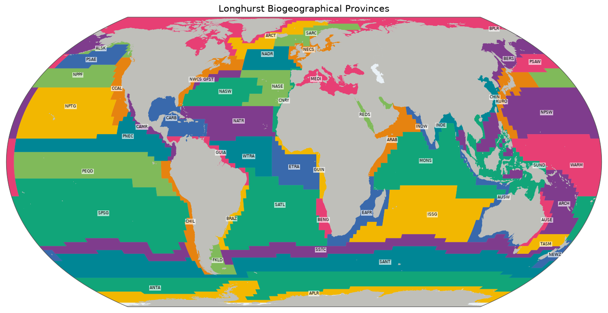

# Longhurst Biogeographical Provinces

The open ocean looks uniform from a ship, but it isn't. Light, mixing and nutrients differ from place to place, and so does the plankton at the base of the food web. The oceanographer Alan Longhurst used this to divide the world's oceans into 54 provinces, each with its own seasonal rhythm of plankton growth. These provinces are widely used in marine ecology to describe where in the sea something lives.

*The 54 provinces by code, drawn from [`overview.geojson`](overview.geojson). Colours only tell neighbours apart. Click for the [SVG](map.svg).*

## Sources and attribution

- **Flanders Marine Institute (VLIZ).** *Longhurst Biogeographical Provinces*, MarineRegions.org, WFS layer [`MarineRegions:longhurst`](https://geo.vliz.be/geoserver/MarineRegions/ows?service=WFS&version=2.0.0&request=GetFeature&typeNames=MarineRegions:longhurst&outputFormat=application/json). [CC BY 4.0](https://creativecommons.org/licenses/by/4.0/). Cite as: *Flanders Marine Institute (VLIZ). MarineRegions.org. Consulted on `built_at`.* The date is in [`build.json`](build.json), along with the exact URL and hashes.
- **Longhurst, A.R.** (2007). *Ecological Geography of the Sea*, 2nd edition. Academic Press. The definition of the provinces.

## How the shapes were made

The polygons are those of the Marine Regions layer, unchanged apart from conversion and simplification. Longhurst drew his provinces from ocean colour and physical data on a coarse grid, hence the stepped edges in the open ocean. The map draws land on top of them, as their coasts are coarse.

The provinces describe oceanography rather than species. For the species-based alternative see [`costello`](../costello/README.md) and [`realm`](../realm/README.md).

## Identifiers and names

Ids are Longhurst's 4-letter province codes (`provcode`), so `longhurst:NADR` is the North Atlantic Drift province and `longhurst:FKLD` the South-West Atlantic Shelves. Labels come from `provdescr` and start with the province's biome, as in `Westerlies - N. Atlantic Drift Province (WWDR)` or `Coastal - SW Atlantic Shelves Province`.

## Technical details

- **Features:** 54, 2.7 MB, EPSG:4326, simplified with Douglas–Peucker at the repository's default of 0.005°.
- **Build:** [`scripts/longhurst/build.py`](../scripts/longhurst/build.py).
- **Backend:** `Gazetteer.LONGHURST`, pattern `^[A-Z]{4}$`.

## References

- Longhurst, A.R. (2007), above.
- Longhurst, A. (1995). Seasonal cycles of pelagic production and consumption. *Progress in Oceanography* 36 (2): 77–167. <https://doi.org/10.1016/0079-6611(95)00015-1>. An early account of the provinces.
- Claus, S., De Hauwere, N., Vanhoorne, B. et al. (2014). Marine Regions: Towards a Global Standard for Georeferenced Marine Names and Boundaries. *Marine Geodesy* 37 (2): 99–125. <https://doi.org/10.1080/01490419.2014.902881>. The project that publishes the layer.
