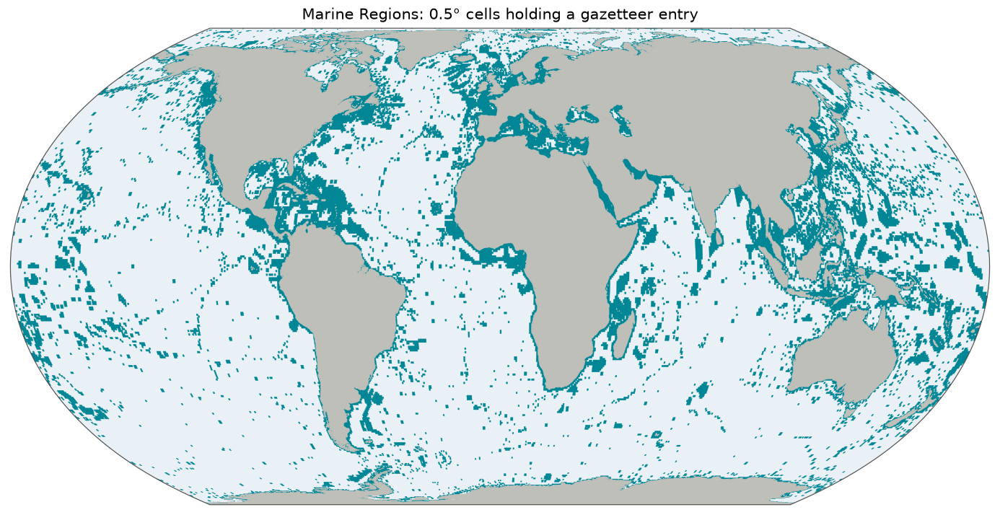

# Marine Regions Gazetteer (MRGID)

A gazetteer is a dictionary of places. [Marine Regions](https://www.marineregions.org/), run by the Flanders Marine Institute (VLIZ), is the standard one for the sea: it lists seas, bays, seamounts, reefs, national waters and also many places on land, each with a stable number, its Marine Regions Geographic Identifier (MRGID). Marine species databases use these numbers to say where a species occurs. So `mrgid:2401`, for example, is the Baltic Sea. This gazetteer holds every entry of Marine Regions that has a usable location: 63,911 of them, of 333 types.

*Too many entries to show one by one, so the map shows the 0.5° grid cells that hold one, drawn from [`overview.geojson`](overview.geojson). It leaves out 20,337 entries, as explained under [Technical details](#technical-details). Click for the [SVG](map.svg).*

## Sources and attribution

- **Flanders Marine Institute (VLIZ).** *MarineRegions.org.* [REST API](https://www.marineregions.org/gazetteer.php?p=webservices) for the records and [WFS](https://geo.vliz.be/geoserver/MarineRegions/ows) for the shapes. [CC BY 4.0](https://creativecommons.org/licenses/by/4.0/), see the [disclaimer](https://www.marineregions.org/disclaimer.php). Cite as: *Flanders Marine Institute (VLIZ). MarineRegions.org. Consulted on `built_at`.*

The shapes come from 113 WFS layers. Among them are `eez`, `lme`, `iho`, `fao`, `longhurst`, `high_seas`, `ecs`, `ices_areas`, `ices_ecoregions`, `arcticmarineareas` and `gazetteer_polygon`, and thematic layers Marine Regions points to, such as those on Antarctica. Marine Regions itself compiles these from many original sources, each credited on its [sources page](https://www.marineregions.org/sources.php). All 113, with their filters and hashes, are in [`build.json`](build.json).

## How the shapes were made

1. **List every record.** The build walks all ids through `getGazetteerRecordByMRGID`, as listing by place type takes hours.
2. **Find its shapes.** For each MRGID, `getGazetteerWMSes` gives pointers to the layer, attribute and value that hold its shape. An entry can have no pointer, one, or many.
3. **Fetch each layer once.** Pointers are grouped by layer, and each layer is fetched in bulk through WFS.
4. **Slice the layers** into one file per MRGID. Several matches for one MRGID, such as a sea split across several polygons, are merged into a MultiPolygon.
5. **Fall back to a point.** An entry with no shape gets a Point from its coordinates, or from the centre of its bounding box. An entry with no location at all is dropped.

So **most entries are points, not areas**: 54,721 of the 63,911. Shapes of one physical region can exist under several ids, since Marine Regions keeps authoritative variants apart: `mrgid:2401` is the Baltic Sea according to the IHO, and `mrgid:8538` the Baltic Sea as a Large Marine Ecosystem. Each feature's `properties.source` names the layer it came from, such as `iho-sea-area` or `large-marine-ecosystem`.

## Identifiers and names

Ids are the MRGID, an integer that Marine Regions keeps stable. Labels are its preferred gazetteer name. The third column of [`labels.tsv`](labels.tsv) is its place type, such as `Bay`, `Seamount(s)` or `Commune`.

## Technical details

- **Features:** 63,911 in EPSG:4326, 698 MB, simplified with Douglas–Peucker at the repository's default of 0.005°. By far the largest gazetteer here.
- **Build:** [`scripts/mrgid/build.py`](../scripts/mrgid/build.py), with [`mrgid_api.py`](../scripts/common/mrgid_api.py). Responses and layers are cached, so a rerun only fetches what is missing, and `--force` wipes the caches. It takes long enough to have its own [workflow](../.github/workflows/build-mrgid.yml).
- **Overview and map:** a coverage overview, one MultiPolygon of the 0.5° cells that entries touch. It shows 43,574 entries and leaves out 20,337: those above 10 square degrees, and the types `ICES Statistical Rectangles`, `Mineral Rights Areas`, `HAB monitoring grid` and `OSPAR Boundary`. Taken together, the entries cover the whole world, which would show nothing, and the survey grids would only draw their lattice.
- **Backend:** `Gazetteer.MRGID`, pattern `^[0-9]+$`. Areas link to `http://marineregions.org/mrgid/{id}`.

## References

- Claus, S., De Hauwere, N., Vanhoorne, B., Deckers, P., Souza Dias, F., Hernandez, F. & Mees, J. (2014). Marine Regions: Towards a Global Standard for Georeferenced Marine Names and Boundaries. *Marine Geodesy* 37 (2): 99–125. <https://doi.org/10.1080/01490419.2014.902881>.
