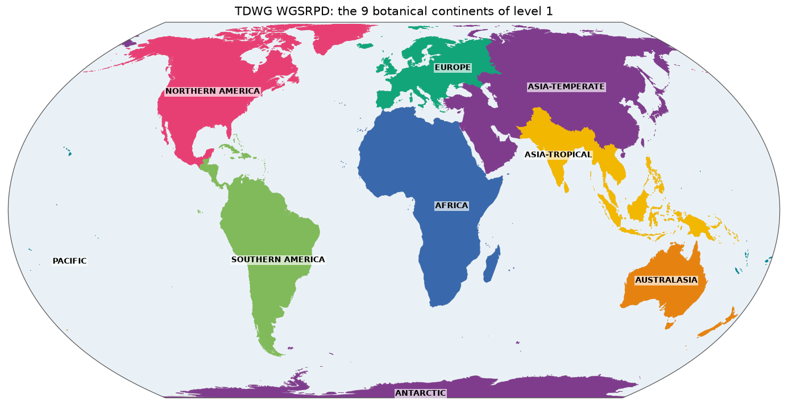

# World Geographical Scheme for Recording Plant Distributions (WGSRPD)

Country borders change and don't follow nature. To record where plants grow in a stable way, botanists agreed on their own map of the world: the *World Geographical Scheme for Recording Plant Distributions*, published by Biodiversity Information Standards (TDWG). It has four nested levels, from 9 botanical continents down to 609 basic units such as individual states and islands. It's the scheme used by floras such as Plants of the World Online.

*The 9 botanical continents of level 1, drawn from [`overview.geojson`](overview.geojson). Colours only tell neighbours apart. Click for the [SVG](map.svg).*

## Sources and attribution

- **Brummitt, R.K.** (2001). *World Geographical Scheme for Recording Plant Distributions*, edition 2. Hunt Institute for Botanical Documentation, Pittsburgh, for TDWG. The standard: <http://www.tdwg.org/standards/109>.
- **Biodiversity Information Standards (TDWG).** [tdwg/wgsrpd](https://github.com/tdwg/wgsrpd) on GitHub, `geojson/level{1,2,3,4}.geojson`. [CC BY 4.0](https://creativecommons.org/licenses/by/4.0/).

The exact files and their hashes are in [`build.json`](build.json).

## How the shapes were made

The shapes are TDWG's own, unchanged apart from simplification. The build unifies the four levels into one tree, as their codes don't collide. The levels nest, so a level 1 continent overlaps all the units inside it.

| Level | Unit | Example | Features |
|---|---|---|---:|
| 1 | Botanical continent | `1` Europe | 9 |
| 2 | Region | `10` Northern Europe | 52 |
| 3 | Botanical country | `ABT` Alberta | 369 |
| 4 | Basic recording unit | `ABT-OO` Alberta | 609, plus 1 alias |

The scheme's boundaries mostly follow political units, but only as far as is convenient for botany. It divides large countries, and groups or separates islands in ways that suit its recording.

## Identifiers and names

Ids are the scheme's own codes: 1 digit for level 1, 2 digits for level 2, 3 letters for level 3, and 3 letters, a hyphen and 2 letters for level 4. Labels are the scheme's `LEVEL{1..4}_NAM` names. Upstream writes level 1 names in capitals, and they are kept like that.

One alias is curated. Upstream ships Slovakia as `CZE-SL`, but about 5,800 distribution records in ChecklistBank use `CZE-SK`, so `ALIASES` in the [build script](../scripts/tdwg/build.py) makes both resolve.

## Technical details

- **Features:** 1,040, 4.4 MB, EPSG:4326, simplified with Douglas–Peucker at the repository's default of 0.005°. Each feature carries the level it came from in `properties.source`.
- **Build:** [`scripts/tdwg/build.py`](../scripts/tdwg/build.py).
- **Overview and map:** level 1 only, as the lower levels subdivide it.
- **Backend:** `Gazetteer.TDWG`, pattern `^(?:[1-9]|[1-9][0-9]|[A-Z]{3}|[A-Z]{3}-[A-Z]{2})$`. Labels are read from here.

## References

- Brummitt (2001), above.
- Hollis, S. & Brummitt, R.K. (1992). *World Geographical Scheme for Recording Plant Distributions*, edition 1. Hunt Institute for Botanical Documentation, Pittsburgh. The first edition.
