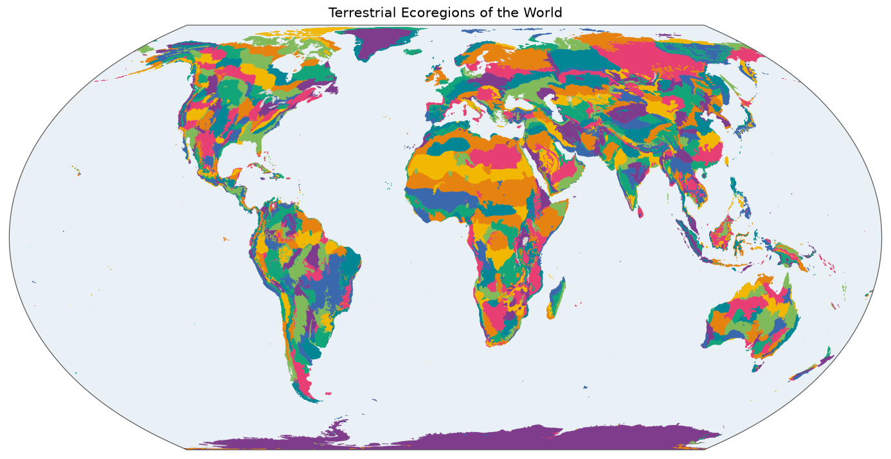

# Terrestrial Ecoregions of the World

An ecoregion is a large piece of land with its own distinct mix of species and natural communities, like the Sonoran desert, or the Eastern Congolian swamp forests. In 2001, David Olson and colleagues at the World Wildlife Fund published the first detailed map of them for the whole world, built with regional experts. It became a standard reference for conservation. The map was updated in 2017, and this gazetteer uses that version, with its 846 ecoregions.

*The ecoregions, drawn from [`overview.geojson`](overview.geojson). Colours only tell neighbours apart. Click for the [SVG](map.svg).*

## Sources and attribution

- **RESOLVE.** *Ecoregions 2017*, <https://storage.googleapis.com/teow2016/Ecoregions2017.zip>. [CC BY 4.0](https://creativecommons.org/licenses/by/4.0/), see <https://ecoregions.appspot.com/>.
- **Dinerstein, E., Olson, D., Joshi, A. et al.** (2017). An Ecoregion-Based Approach to Protecting Half the Terrestrial Realm. *BioScience* 67 (6): 534–545. <https://doi.org/10.1093/biosci/bix014>.

The exact file and its hashes are in [`build.json`](build.json).

## How the shapes were made

The shapes are RESOLVE's, unchanged apart from conversion and simplification. One feature per ecoregion.

The dataset also has one entry that is not an ecoregion, `teow:0`, "Rock and Ice", which covers the Greenland and Antarctic ice sheets and mountain glaciers. It is shipped as it is, which is why this gazetteer has 847 features for 846 ecoregions.

Lakes are not part of any ecoregion, and are holes in the map. [`realm`](../realm/README.md), built from the same file, groups the ecoregions into 8 realms, and has to deal with those holes and with Rock and Ice.

## Identifiers and names

Ids are the integer `ECO_ID` of the source. They aren't consecutive. `teow:1` is the Albertine Rift montane forests. Labels come from `ECO_NAME`.

## Technical details

- **Features:** 847, 38 MB, EPSG:4326, simplified with Douglas–Peucker at the repository's default of 0.005°.
- **Build:** [`scripts/teow/build.py`](../scripts/teow/build.py).
- **Backend:** `Gazetteer.TEOW`, pattern `^[0-9]+$`.

## References

- Olson, D.M., Dinerstein, E., Wikramanayake, E.D. et al. (2001). Terrestrial Ecoregions of the World: A New Map of Life on Earth. *BioScience* 51 (11): 933–938. The original map, of which RESOLVE's is the update. The gazetteer's name and its `teow` prefix come from it.
- Dinerstein et al. (2017), above.
